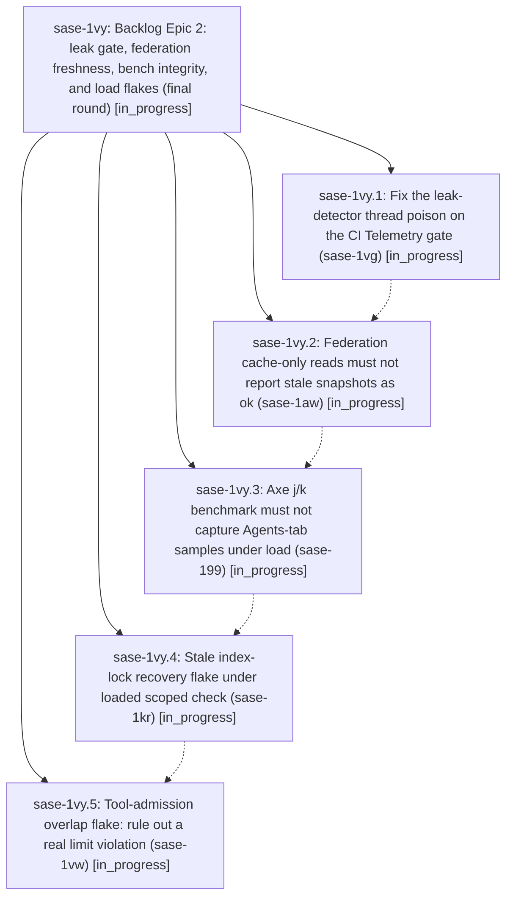

# Bead: sase-1vy — Backlog Epic 2: leak gate, federation freshness, bench integrity, and load flakes (final round)

[Bead Pages](../README.md) / sase-1vy

**Status:** ◐ in_progress · **Type:** ▸ plan · **Tier:** epic
**Owner:** `bryanbugyi34@gmail.com` · **Created by:** [bbugyi200.athena.sase-1vn.land](https://github.com/sase-org/sase--agents/blob/main/sessions/bbugyi200.athena.sase-1vn.land.md) · **Assignee:** `sase-1vy.land`
**Created:** 2026-11-28 03:14:44 EST
**Plan:** [202611/backlog\_epic\_2.md](https://github.com/sase-org/sase--plans/blob/main/202611/backlog_epic_2.md)

<!-- sase:links:start -->

## Links

| Relation | Artifact | Why |
| --- | --- | --- |
| implemented-by | [plan:202611/backlog_epic_2.md][1] | derived from the plan's `bead_id:` frontmatter field |

[1]: https://github.com/sase-org/sase--plans/blob/main/202611/backlog_epic_2.md

<!-- sase:links:end -->

## Description

The five most important remaining open task beads are fixed and closed. The land agent verifies, closes this final epic, and stops: the user capped the backlog chain at two rounds, so no Backlog Epic 3 is planned.

## Phases

| Bead | Title | Status | Size | Created | Agents | Commits |
|---|---|---|---|---|---:|---:|
| [sase-1vy.1](sase-1vy.1.md) | Fix the leak-detector thread poison on the CI Telemetry gate (sase-1vg) | ◐ in_progress | large | 2026-11-28 | 1 | 1 |
| [sase-1vy.2](sase-1vy.2.md) | Federation cache-only reads must not report stale snapshots as ok (sase-1aw) | ◐ in_progress | medium | 2026-11-28 | 1 | 0 |
| [sase-1vy.3](sase-1vy.3.md) | Axe j/k benchmark must not capture Agents-tab samples under load (sase-199) | ◐ in_progress | large | 2026-11-28 | 1 | 0 |
| [sase-1vy.4](sase-1vy.4.md) | Stale index-lock recovery flake under loaded scoped check (sase-1kr) | ◐ in_progress | large | 2026-11-28 | 1 | 0 |
| [sase-1vy.5](sase-1vy.5.md) | Tool-admission overlap flake: rule out a real limit violation (sase-1vw) | ◐ in_progress | large | 2026-11-28 | 1 | 0 |

## Lineage

## Agents

| Agent | Bead | Commits |
|---|---|---:|
| [bbugyi200.athena.sase-1vy.1](https://github.com/sase-org/sase--agents/blob/main/sessions/bbugyi200.athena.sase-1vy.1.md) | [sase-1vy.1](sase-1vy.1.md) | 1 |
| [bbugyi200.athena.sase-1vy.2](https://github.com/sase-org/sase--agents/blob/main/agents/bbugyi200.athena.sase-1vy.2/README.md) | [sase-1vy.2](sase-1vy.2.md) | 0 |
| [bbugyi200.athena.sase-1vy.3](https://github.com/sase-org/sase--agents/blob/main/agents/bbugyi200.athena.sase-1vy.3/README.md) | [sase-1vy.3](sase-1vy.3.md) | 0 |
| [bbugyi200.athena.sase-1vy.4](https://github.com/sase-org/sase--agents/blob/main/agents/bbugyi200.athena.sase-1vy.4/README.md) | [sase-1vy.4](sase-1vy.4.md) | 0 |
| [bbugyi200.athena.sase-1vy.5](https://github.com/sase-org/sase--agents/blob/main/agents/bbugyi200.athena.sase-1vy.5/README.md) | [sase-1vy.5](sase-1vy.5.md) | 0 |
| [bbugyi200.athena.sase-1vy.land](https://github.com/sase-org/sase--agents/blob/main/agents/bbugyi200.athena.sase-1vy.land/README.md) | [sase-1vy](README.md) | 0 |

## Commits

| Repo | Commit | Subject | Bead | Committed |
|---|---|---|---|---|
| sase | [`42255c3`](https://github.com/sase-org/sase/commit/42255c3cce19e85ac18053d9b92921168c67c5c4) | fix(tui): drain header enrichment before config token refresh | [sase-1vy.1](sase-1vy.1.md) | 2026-11-28 05:14:42 EST |
